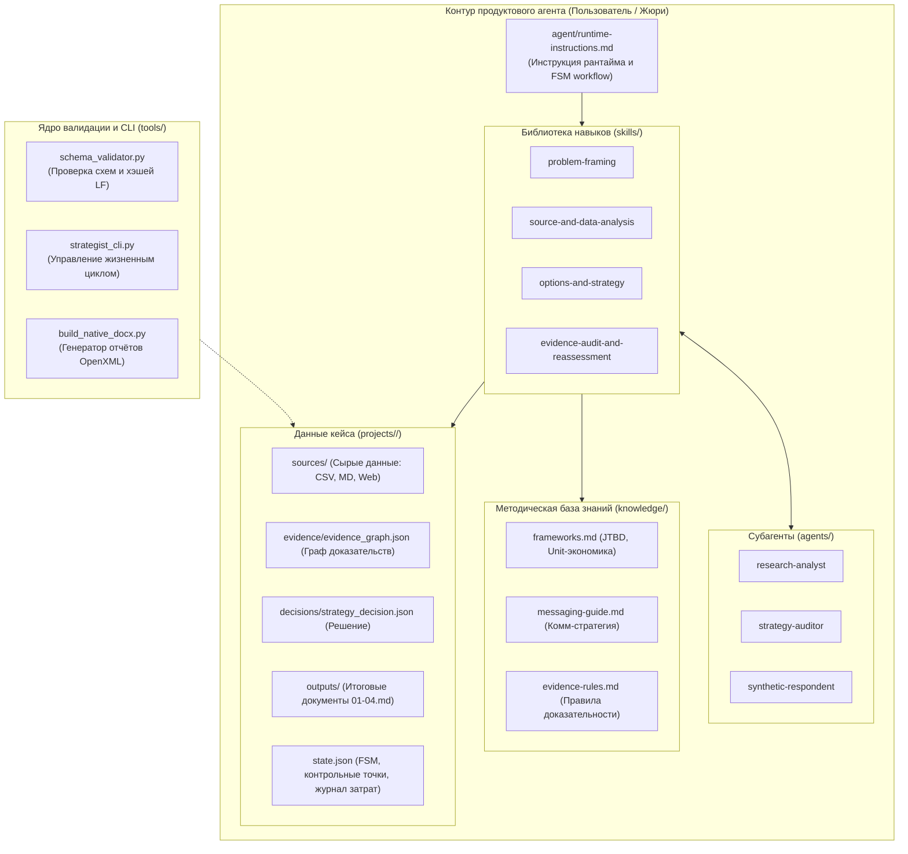

# MGIMOv3 — «Стратег Фабрики продуктов» (МегаФон)

[](docs/contest-brief.md)
[](https://www.python.org/)
[](#технологический-стек)
[](#проверка-и-тестирование)
[](#безопасность-и-данные)

> **ИИ-агент для руководителя цифрового продукта (CPO / Lead PM)**, который помогает пройти сквозной путь от размытого бизнес-запроса до обоснованной продуктовой и коммуникационной стратегии, а также сопровождает принятые решения после утверждения (каскадный пересмотр при обновлении данных).

Репозиторий представляет собой полностью автономный проект-папку с инструкциями, базой знаний, навыками, субагентами и верифицируемым ядром. Проект открывается и работает в любой ИИ-среде разработки: **Google Antigravity, Cursor, Claude Code, Windsurf, GigaCode, Codex**.

---

## 🚀 Быстрый старт (Quick Start за 1 минуту)

Проект работает **из коробки** на чистом Python 3.10+ **без сторонних pip-зависимостей** (Zero External Dependencies) и **без скрытых API-ключей**.

```bash
# 1. Переход в директорию проекта
cd MGIMOv3

# 2. Проверка целостности ядра и схемы демонстрационного кейса (0 ошибок)
python tools/schema_validator.py --case projects/demo_mvp --strict

# 3. Запуск полного пакета автоматических тестов (53/53 PASS)
python -m unittest discover -s tests -v

# 4. Просмотр статуса демо-кейса через CLI
python tools/strategist_cli.py status --case projects/demo_mvp
```

---

## 🎯 Реализация требований конкурсного задания МегаФона

| Направление оценки ТЗ | Фокус требований | Как реализовано в репозитории |
|---|---|---|
| **1. Проработанность стратегии** | Доказательность, альтернативы, согласованность | • Выводы строятся строго на доказательствах графа (`evidence_graph.json`).<br>• Вырабатываются **3 содержательно разных варианта** (включая *«Оставить как есть»* и *«Закрыть направление»*) с сильными контраргументами.<br>• Продуктовая и коммуникационная стратегии синхронизированы через матрицу каналов и сообщений (`outputs/03_product_and_comm_strategy.md`).<br>• План проверки с контр-метриками и сроками наблюдения (`outputs/04_validation_plan_and_governance.md`). |
| **2. Масштаб нейротехнологий** | Оркестрация, субагенты, синтетические инсайты | • 9-этапный конечный автомат рабочего процесса (`agent/runtime-instructions.md`).<br>• Специализированные субагенты: `research-analyst`, `strategy-auditor`, `synthetic-respondent` (`agents/`).<br>• Библиотека повторяемых навыков (`skills/`).<br>• Честная работа с модельными респондентами: синтетические интервью маркируются `SYNTHETIC_BENCHMARK / HYPOTHESIS_EXPLORATION` и не выдаются за рыночный факт.<br>• Каскадный пересмотр выводов при отзыве или изменении любого источника. |
| **3. Имплементация и переносимость** | Автономность, сохранность состояния, безопасность | • Запуск без единого стороннего `pip install` (использована стандартная библиотека Python + встроенный генератор OpenXML DOCX).<br>• **State Recovery:** сохранение контрольных точек (`state.json`), возможность остановить диалог и продолжить в новом сеансе.<br>• Защита от Prompt Injection: данные из файлов и сайтов изолируются как пассивный текст и не меняют правила агента.<br>• Zero Secrets: пароли и приватные ключи в репозитории отсутствуют. |
| **4. Качество и экономичность** | Прозрачность затрат, контроль человека, отчёты | • Прозрачный журнал расходов токенов, времени и стоимости вызовов моделей (`cost_and_usage_ledger`).<br>• Понятный интерфейс для руководителя продукта с контролем контрольных точек (Human-in-the-Loop).<br>• Готовые форматы выдачи: Markdown, JSON и нативные документы Word (`.docx`). |

---

## 🏛 Архитектура системы

Архитектура построена по принципу **строгого разделения контуров** и уровней знаний:



### Жизненный цикл продуктовой задачи (Workflow):
1. **INTAKE** — разбор размытого брифа, фиксация целей, ограничений и ключевых лиц.
2. **RESEARCH_PLANNING** — декомпозиция на исследовательские вопросы `Q-xxx`.
3. **EVIDENCE_COLLECTION** — сбор разнородных данных (CSV, интервью, веб), расчёт хэшей `sha256`.
4. **EVIDENCE_VALIDATION** — проверка на пропуски, единицы измерения, фиксация пробелов `G-xxx` и противоречий `X-xxx`.
5. **OPTIONS_GENERATION** — синтез 3 альтернатив (включая «Оставить как есть» и «Закрыть направление»).
6. **STRATEGY_DESIGN** — проектирование взаимосвязанной продуктовой и коммуникационной стратегии.
7. **INDEPENDENT_REVIEW** — критический аудит субагентом `strategy-auditor` с сильными возражениями.
8. **HUMAN_DECISION** — утверждение стратегии человеком (Human-in-the-Loop).
9. **DECISION_MONITORING** — мониторинг триггеров, каскадный пересмотр при изменении фактов.

---

## 📁 Структура репозитория

```
MGIMOv3/
├── AGENTS.md                  # Корневой контракт агента (защищён контрольной суммой SHA-256)
├── README.md                  # Презентация проекта, быстрый старт и документация
├── agent/                     # Инструкции рантайма и переходы состояний
│   └── runtime-instructions.md
├── agents/                    # Роли и промпты субагентов (auditor, analyst, respondent)
├── skills/                    # Повторяемые процедуры и навыки агента
├── knowledge/                 # Методические знания (JTBD, юнит-экономика, правила доказательств)
├── projects/
│   └── demo_mvp/              # Готовый сквозной демонстрационный проект МегаФона
│       ├── brief.md           # Первичный бриф руководителя продукта
│       ├── sources/           # Исходные файлы (billing_funnel.csv, product_analytics.csv, etc.)
│       ├── evidence/          # Граф доказательств (S-xxx, F-xxx, C-xxx, G-xxx, X-xxx)
│       ├── decisions/         # Зафиксированное решение и альтернативы
│       ├── outputs/           # 4 итоговых отчёта для топ-менеджмента
│       └── state.json         # Состояние FSM, целостность артефактов и учёт затрат
├── schemas/                   # JSON-схемы валидации всех структур данных
├── tools/                     # CLI-утилиты, строгий валидатор схем и нативный DOCX-генератор
├── tests/                     # Автоматические тесты (39 unit + 12 end-to-end сценариев)
└── docs/                      # Конкурсное ТЗ, архитектурные решения (ADR) и отчёты
    └── reports/               # Сгенерированные итоговые DOCX-отчёты
```

---

## 🧪 Проверка и тестирование

В репозитории реализован полный сьют автоматических тестов (53 теста):
* **41 модульный тест (`tests/unit/`)**: валидация схем, вычисление контрольных сумм источников, изоляция prompt injection, расчёт метрик юнит-экономики, локализация поиска источников в изолированных копиях кейсов и динамические метаданные отчётов.
* **12 сценарных тестов (`tests/scenarios/test_acceptance_t01_t12.py`)**: сквозная верификация всех обязательных и дополнительных требований ТЗ МегаФона (T01–T12), включая восстановление после прерывания и реакцию на изменение источника данных.

Команды запуска:
```bash
# Прогон модульных тестов
python -m unittest discover -s tests/unit -v

# Прогон сценарных приёмочных тестов
python -m unittest discover -s tests/scenarios -v

# Строгая валидация кейса demo_mvp на соответствие схемам и хэшам источников
python tools/schema_validator.py --case projects/demo_mvp --strict
```

---

## 🔒 Безопасность и данные

1. **Защита от Prompt Injection**: любой текст из сторонних источников и файлов анализируется исключительно как пассивные данные. Инструкции внутри источников не могут переопределить системные правила агента.
2. **Конфиденциальность и Zero Secrets**: проект не содержит персональных данных и закрытых коммерческих тайн МегаФона. Все примеры построены на открытых или учебных данных (`Synthetic Benchmark`). В репозитории нет паролей и API-токенов.
3. **Честность доказательств**: агент никогда не выдаёт гипотезы, прогнозы или ответы синтетических респондентов за доказанные рыночные факты. Любое существенное утверждение строго ссылается на источник `S-xxx` или факт `F-xxx`.

---

## 📄 Документы для жюри

Сгенерированные официальные документы находятся в папке `docs/reports/`:
* **[01_Full_System_Audit_Report.docx](docs/reports/01_Full_System_Audit_Report.docx)** — Полный системный отчёт об архитектуре, результатах аудита и верификации критериев конкурса.
* **[02_Interactive_Session_Decisions_and_Prompts_Log.docx](docs/reports/02_Interactive_Session_Decisions_and_Prompts_Log.docx)** — Интерактивный журнал сессии: принятые решения, промпты агентов и обоснования.
