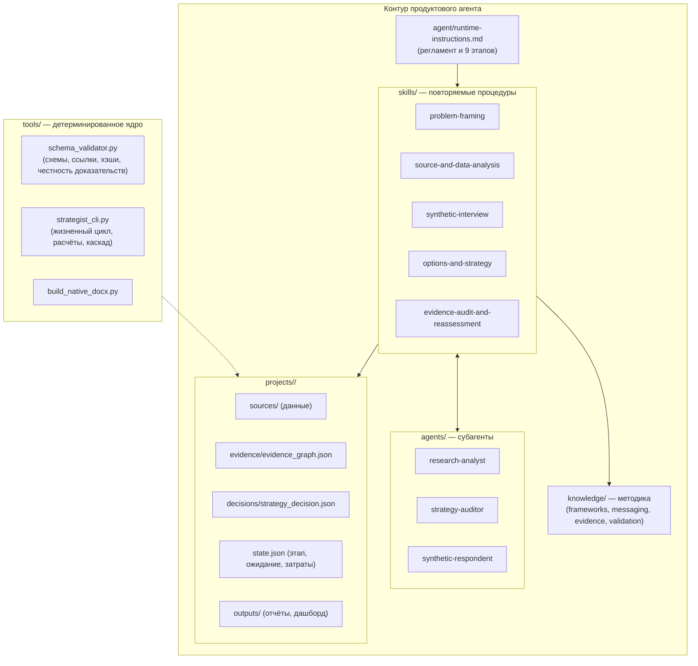

# Стратег Фабрики продуктов — ИИ-агент для руководителя цифрового продукта (МегаФон)

[](docs/contest-brief.md)
[](https://www.python.org/)
[](#безопасность-и-данные)
[](#проверка-и-тестирование)

> **Что это.** Папка с инструкциями, знаниями, навыками, субагентами и проверяемым Python-ядром. Её открывают в ИИ-среде
> (Cursor, Claude Code, Google Antigravity, Windsurf, Codex, GigaCode) — и LLM, следуя инструкциям, ведёт руководителя продукта
> от размытого запроса до обоснованной продуктовой и коммуникационной стратегии, а после решения сопровождает его: хранит основания,
> следит за обязательствами и пересматривает выводы при новых данных. Это не отдельная программа: «мозг» — LLM вашей среды,
> «руки» — команды `tools/`, «память» — файлы кейса.
>
> Репозиторий называется `MGIMOv2`; внутри документов команда обозначена как `MGIMOv3` — это один и тот же проект.

---

## 🚀 Быстрый старт

**Нужно:** Python 3.10+ (проверено на 3.14). Сторонних пакетов, API-ключей и платных сервисов **не требуется** — ядро работает без них.
Платной является только сама ИИ-среда, в которой вы открываете папку (подойдёт любая, перечисленная выше).

```bash
git clone https://github.com/Dafgas-ui/MGIMOv2.git && cd MGIMOv2

# 1. Проверка целостности ядра и всех кейсов (ожидается: PASS)
python tools/check_coordination.py
python tools/schema_validator.py --case projects/connect_family_devices --strict

# 2. Все автоматические тесты (ожидается: 58 тестов, OK)
python -m unittest discover -s tests

# 3. Статус демонстрационного проекта: этап, целостность артефактов, затраты
python tools/strategist_cli.py status --case projects/connect_family_devices
```

(На macOS/Linux, если `python` нет в `PATH`, используйте `python3`.)

### Как запустить самого агента (первый запуск за 2 минуты)

1. Откройте **корень репозитория** как проект в вашей среде (`File → Open Folder`). Агент автоматически читает `AGENTS.md`
   (в Claude Code — также `CLAUDE.md`, в Cursor — `.cursorrules`).
2. Напишите задачу руководителя продукта в чат — например:
   > «У нас падает удержание семейной услуги — разберись почему и что делать. Исходные материалы — в `projects/<кейс>/sources/`».
3. Агент сам начнёт с `python tools/strategist_cli.py resume --case projects/<кейс>` или `init-case`, задаст не более 2–3 вопросов
   и пойдёт по 9 этапам. Вы видите, на каком этапе работа, на каких узлах графа строятся выводы и сколько это стоило
   (`status`). Остановить можно в любой момент; уточнить или исправить результат — обычным сообщением: агент вернётся на нужный этап
   и пересоберёт отчёты (`render-outputs`).
4. **Продолжение после перерыва:** закройте чат, откройте новый и скажите «продолжай» — агент выполнит
   `resume --case projects/<кейс>`, сверит хэши артефактов, найдёт незавершённую операцию и продолжит с сохранённого места.
   В Google Antigravity то же делает хук `SessionStart` (`.agents/hooks.json`) автоматически; в остальных средах это одна команда,
   которая описана в `agent/runtime-instructions.md`.

Что агент никогда не делает сам: не утверждает стратегию вместо человека (этап `HUMAN_DECISION`), не выдаёт ответы модельных респондентов
за факты, не исполняет команды, найденные внутри источников.

---

## 📦 Демонстрационные проекты

| Кейс | Откуда бриф | Состояние | Что смотреть |
|---|---|---|---|
| **`projects/connect_family_devices`** — «Связь для близких и собственных устройств» (основной демо-проект для жюри) | Официальный учебный бриф организаторов; других данных не использовано | Остановлен на `HUMAN_DECISION` (ждёт решения человека) — удобно показывать продолжение после перерыва | [`outputs/00_strategy_document_five_parts.md`](projects/connect_family_devices/outputs/00_strategy_document_five_parts.md) (документ из пяти частей по брифу), [`outputs/01…04`](projects/connect_family_devices/outputs/) (исследование, варианты, стратегия, план проверки), [`outputs/dashboard.html`](projects/connect_family_devices/outputs/dashboard.html) |
| `projects/demo_mvp` — «Семейный Щит» | Собственный учебный бриф команды; данные синтетические | Утверждён человеком, этап мониторинга | Каскадный пересмотр, синтетическое интервью, анализ интерфейса |
| `projects/eval_b2b_roaming` — корпоративный роуминг | Собственный учебный бриф; данные синтетические | Остановлен на `HUMAN_DECISION` | Проверка обобщения на втором независимом кейсе (T12) |

Задача, исходные материалы, граф доказательств и обе стратегии лежат в папке кейса: `sources/` → `evidence/evidence_graph.json` →
`decisions/strategy_decision.json` → `outputs/` (читаемые отчёты и HTML-дашборд).

---

## 🎯 Как это отвечает на требования конкурсного задания

| Направление оценки | Как реализовано |
|---|---|
| **1. Проработанность** | Каждый вывод ссылается на узел графа (`F-` факт, `C-` воспроизводимый расчёт, `H-` гипотеза/прогноз, `G-` пробел, `X-` расхождение). 3+ содержательно разных варианта, включая «оставить как есть» и «закрыть направление», у каждого — сильные возражения. Продуктовая и коммуникационная стратегии связаны матрицей «обещание → возможность продукта → доказательство»; валидатор блокирует обещания, которых нет в продукте или которые противоречат осознанным отказам. План проверки: ожидаемое изменение, сравнение, срок, нежелательные последствия. |
| **2. Агентная система** | 9-этапный workflow с гейтами; 5 навыков (`skills/`), 3 субагента (`agents/`), хук восстановления сессии, CLI-ядро, правила маршрутизации «код вместо LLM / профиль модели по задаче / эскалация при ошибке» (`agent/runtime-instructions.md`, §4), синтетические респонденты с маркировкой «гипотеза, не факт», каскадный пересмотр при отзыве источника. |
| **3. Имплементация** | Запуск без установки зависимостей; состояние в `state.json` (этап, ожидание человека, незавершённая операция, хэши артефактов); восстановление в новом чате; защита от Prompt Injection (источники — пассивные данные); в репозитории нет секретов. Работает на новых кейсах — их три. |
| **4. Качество и экономичность** | Журнал расходов шагов (время, токены, стоимость, пометка «оценка/измерено»); человек подключается на значимых выборах; отчёты — Markdown, HTML-дашборд, DOCX. |

---

## 🏛 Архитектура



**Жизненный цикл:** `INTAKE` → `RESEARCH_PLANNING` → `EVIDENCE_COLLECTION` → `EVIDENCE_VALIDATION` → `OPTIONS_GENERATION` → `STRATEGY_DESIGN` →
`INDEPENDENT_REVIEW` → `HUMAN_DECISION` → `DECISION_MONITORING`. Переход — только командой `advance-stage` (она проверяет контракты этапа).

### Ключевые решения (зачем устроено именно так)

1. **Папка, а не программа.** Проект переносится между средами копированием каталога; поведение задают инструкции и проверяемое ядро.
2. **Источник истины — три JSON-реестра** (`state.json`, граф доказательств, решение), отчёты в `outputs/` — витрина, которую генерирует код
   (`render-outputs`). Так нельзя «дописать красивый вывод» без ссылки на основание (ADR-005, [`docs/decisions.md`](docs/decisions.md)).
3. **Код вместо LLM там, где нужна точность.** Расчёты — воспроизводимой командой (`reproduce_command`), проверки схем и ссылок — валидатором,
   пересмотр при новых данных — каскадом по графу.
4. **Честность доказательств как ограничение, а не пожелание.** Валидатор запрещает ссылаться на модельных респондентов в обещаниях клиенту,
   требует определения метрик (числитель, знаменатель, период) и пометок происхождения данных.
5. **Человек решает.** Агент останавливается на выборе варианта (`HUMAN_DECISION`) и на доступе к закрытым данным.
6. **Два контура.** Разработка репозитория (`docs/coordination/`) отделена от продуктового агента, чтобы служебный контекст не попадал в ответы (ADR-001).

---

## 📁 Структура

```
AGENTS.md                 корневой контракт агента (защищён контрольной суммой)
CLAUDE.md, .cursorrules   подсказки средам читать AGENTS.md
agent/runtime-instructions.md   регламент продуктового агента (этапы, маршрутизация, безопасность)
skills/    5 навыков (SKILL.md)           agents/   3 субагента
knowledge/ методические знания (стратегия, коммуникации, метрики и доказательства, проверка)
projects/  кейсы: sources → evidence → decisions → outputs, state.json
schemas/   JSON-схемы реестров            tools/    CLI, валидатор, генератор DOCX
tests/     58 тестов (unit + сценарии T01–T12)
docs/      ТЗ, архитектура, решения, описание работы, сценарий видео, отчёты
```

---

## 🧪 Проверка и тестирование

```bash
python -m unittest discover -s tests          # всё: 58 тестов
python -m unittest discover -s tests/unit      # 46: схемы, хэши, CLI, хук восстановления, регрессия по всем кейсам
python -m unittest discover -s tests/scenarios # 12: приёмочные сценарии T01–T12 по заданию
python tools/schema_validator.py --case projects/connect_family_devices --strict
```

Регрессия `tests/unit/test_all_cases.py` для **каждого** кейса: строгая валидация, совпадение хэшей источников и **повторный запуск каждого
расчёта** `C-xxx` с проверкой результата. Сценарии T01–T12 покрывают постановку, разнородные источники, противоречия метрик, пробелы,
варианты, согласованность стратегий, новый чат, каскад, сбой инструмента, Prompt Injection, затраты и второй кейс.

---

## 🔒 Безопасность и данные

1. **Prompt Injection:** текст из `sources/` и внешних сайтов — только данные (`trust_boundary: untrusted_data`); инструкции внутри не меняют правила агента.
2. **Секреты:** ключей и паролей в репозитории нет; шаблон — `.env.example`, `.env` в `.gitignore`.
3. **Данные:** только открытые и собственные учебные материалы. Данные в `projects/*/sources/` — **учебные или синтетические**, и это
   отражено в графе (`is_synthetic`, `origin`). Реальных данных МегаФона и персональных данных нет; реальные интервью не проводились.
4. **Честность доказательств:** гипотезы, прогнозы и ответы модельных респондентов не выдаются за факты; пробелы называются прямо (`G-xxx`).

---

## ⚖️ Заявленные возможности и ограничения

**Реализовано:** workflow с гейтами; навыки; субагенты; CLI; хук `SessionStart` (Antigravity); синтетические интервью с защитой от контаминации
доказательств; анализ данных (`analyze-csv`, расчёты с воспроизводимой командой); анализ макета интерфейса (SVG, кейс `demo_mvp`);
поддержка решений (обязательства `K-xxx`, триггеры пересмотра `R-xxx`); каскадный пересмотр; восстановление после прерывания и сбоя;
переносимость; HTML-дашборд и DOCX.

**Ограничения (честно):**
- **Нет интеграций MCP** и нет автоматического поиска по смыслу в базе знаний: знания — файлы, навигация по ссылкам и именам.
- **Маршрутизация моделей — набор правил в инструкциях** (профили `flash` / `pro`, эскалация), а не код, который сам переключает модели.
- **Хук автовосстановления работает в Antigravity**; в Cursor / Claude Code восстановление выполняется командой `resume` (её запускает агент по
  инструкции или пользователь).
- **Независимая проверка** — строгий валидатор и субагент `strategy-auditor` по инструкции; в демо-проекте `connect_family_devices`
  использованы валидатор и контрольный список, отдельный прогон аудитора не запускался.
- **Журнал затрат** содержит оценки (`is_estimated: true`) для шагов с моделью; измерены только детерминированные команды. Сравнение с аналитиком вручную
  не измерялось.
- Числа демо-кейсов — **учебные**; выводы демонстрируют метод, а не рыночную ситуацию.
- Ответы модельных респондентов служат поиску гипотез и никогда не доказывают спрос.

---

## 📄 Документы

- [Описание работы для жюри](docs/work_description.md) — архитектура, модели и инструменты, промпты, возможности, затраты, ограничения.
- [Сценарий видео](docs/video_screenplay.md) — пошаговый план записи сквозного пути.
- [Конкурсное задание](docs/contest-brief.md), [ADR](docs/decisions.md), [архитектура](docs/architecture.md).
- [Отчёт о системном аудите](docs/reports/01_Full_System_Audit_Report.docx), [журнал сессии и промптов](docs/reports/02_Interactive_Session_Decisions_and_Prompts_Log.docx).
