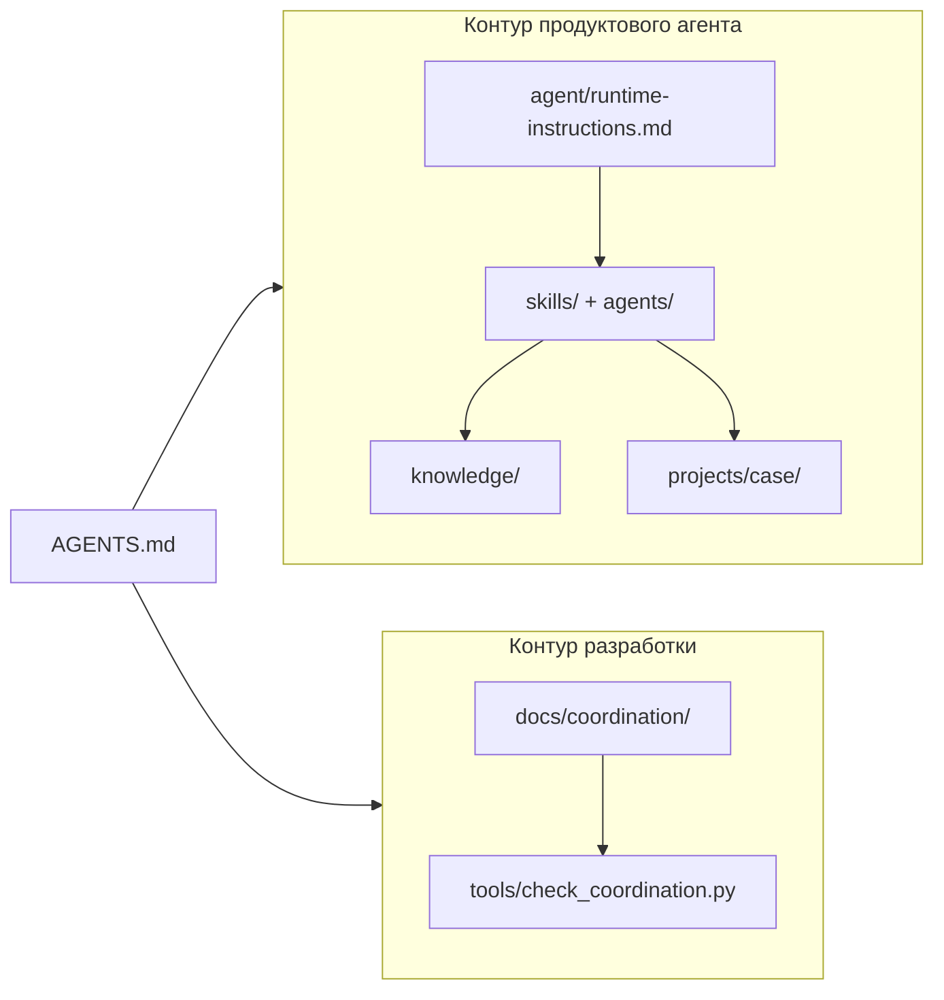

# Архитектура

## Два контура

- **Контур 2 — продуктовый агент:** `agent/`, `skills/`, `agents/`, `knowledge/`, `projects/<case>/`, `schemas/`, `tools/strategist_cli.py`.
- **Контур 1 — разработка:** `docs/coordination/` и роли `Argon-Prime`, `Sonnet-Staff`, `Opus-Core`, `Opus-Mind`, `Argon-Judge`. Продуктовый агент о нём не знает и не упоминает.

## Поток продуктового агента

`INTAKE` → `RESEARCH_PLANNING` → `EVIDENCE_COLLECTION` → `EVIDENCE_VALIDATION` → `OPTIONS_GENERATION` → `STRATEGY_DESIGN` → `INDEPENDENT_REVIEW` → `HUMAN_DECISION` → `DECISION_MONITORING`

## Разделение знаний

Постоянные инструкции (`agent/`), методика (`knowledge/`), материалы проекта (`projects/<case>/sources`), состояние и решения (`evidence/`, `decisions/`), результаты (`outputs/`) хранятся раздельно.

## Координация разработки

Общая файловая память в `docs/coordination/`: `workflow.md`, `task-board.md`, `project-status.md`, `review-handoff.md`. Целостность проверяет `tools/check_coordination.py`.
