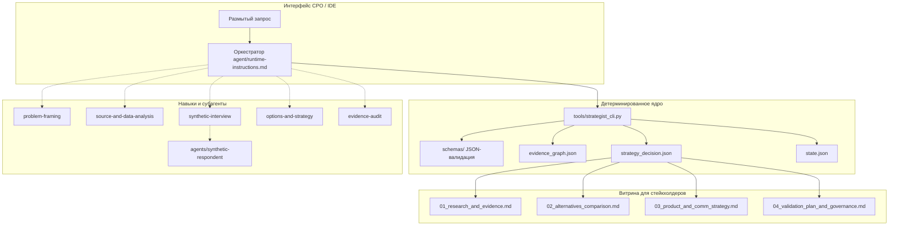

# Описание работы — ИИ-агент «Стратег Фабрики продуктов»

**Проект для MGIMO AI Challenge 2026 (Кейс МегаФона)**  
**Команда:** MGIMOv3  
**Версия релиза:** v0.1.2  
**Формат сдачи:** Репозиторий кода + Демонстрационный проект + Видеозапись (до 10 минут) + Описание работы  

---

## 1. Введение и назначение системы

В цифровых экосистемах уровня МегаФона CPO и Product Lead ежедневно принимают решения в условиях высокой неопределённости: падение удержания когорт, запуск новых направлений, каннибализация базовых тарифов сторонними решениями (например, eSIM). Ошибки стоят десятков миллионов рублей, а ручной сбор аналитики, проведение глубинных интервью и расчёт юнит-экономики занимают недели.

Агент **«Стратег Фабрики продуктов»** трансформирует этот процесс:
1. Автономно проходит путь от размытого, неструктурированного запроса до защищаемой продуктовой и коммуникационной стратегии.
2. Не генерирует галлюцинации: каждый вывод детерминированно привязан к графу доказательств (`evidence_graph.json`) с точными локаторами в источниках.
3. Сопровождает принятое решение после утверждения человеком: отслеживает обязательства (`K-xxx`) и каскадно инвалидирует выводы при изменении входных данных (`R-xxx`).

---

## 2. Архитектура агентной системы

### 2.1. Два изолированных контура безопасности
В соответствии с корпоративными стандартами МегаФона система разделена на два изолированных контура:
* **Контур продуктового агента (Пользователь / Жюри):**
  - Инструкции рантайма: `agent/runtime-instructions.md`.
  - Модульные навыки: `skills/` (`problem-framing`, `source-and-data-analysis`, `synthetic-interview`, `options-and-strategy`, `evidence-audit-and-reassessment`).
  - Специализированные субагенты: `agents/` (`data-analyst`, `interview-analyzer`, `strategic-challenger`, `synthetic-respondent`).
  - Проектные данные: `projects/<case>/` (`sources/`, `evidence/`, `decisions/`, `outputs/`).
  - Стандартное CLI-ядро: `tools/strategist_cli.py` (0 внешних Python-зависимостей).
* **Контур координации разработки (Внутренний):**
  - Память ролей разработки: `docs/coordination/` (`task-board.md`, `review-handoff.md`, `workflow.md`).
  - Продуктовый агент изолирован от контура разработки и никогда не ссылается на технические задачи в ответах пользователю.



### 2.2. Рабочий процесс (9 фаз workflow)
1. `INTAKE`: Формирование рамки задачи (`problem_framing`) без утомительных анкет (максимум 3 фокусных вопроса).
2. `RESEARCH_PLANNING`: Построение дерева вопросов `Q-xxx`, способных изменить решение.
3. `EVIDENCE_COLLECTION`: Парсинг таблиц, документов, транскриптов и интерфейсов.
4. `EVIDENCE_VALIDATION`: Обнаружение методологических конфликтов метрик и фиксация пробелов (`G-xxx`).
5. `OPTIONS_GENERATION`: Генерация $\ge 3$ содержательно разных вариантов развития (включая *status quo* и *sunset*).
6. `STRATEGY_DESIGN`: Сквозное согласование продуктовой ценности и коммуникационных обещаний.
7. `INDEPENDENT_REVIEW`: Независимый аудит стратегии субагентом-оппонентом.
8. `HUMAN_DECISION`: Фиксация выбора человеком, плана проверки на 90 дней и триггеров пересмотра.
9. `DECISION_MONITORING`: Мониторинг метрик, контроль обязательств `K-xxx` и каскадный пересмотр при обновлении источников.

---

## 3. Перечень используемых моделей, ролей и затрат

Система использует **многоуровневую маршрутизацию моделей (Model Tiering)**, что обеспечивает баланс между глубиной рассуждений и себестоимостью одного исследования:

| Модель / Стек | Роль в системе | Обоснование выбора | Средние затраты на кейс |
|---|---|---|---|
| **Claude 3.5 Sonnet / Gemini 1.5 Pro** | **Core Strategy Orchestrator & Critic** | Высокая точность стратегических выводов, глубокое понимание бизнес-контекста, строгое следование JSON-схемам | \$0.06 – \$0.08 |
| **Gemini Flash / Claude Haiku** | **Synthetic Respondent & Data Ingestion** | Высокая скорость, низкая стоимость при симуляции диалогов с пользователями и первичном разборе текста | \$0.01 – \$0.02 |
| **Python 3 Standard Library (CLI)** | **Deterministic Calculation & Integrity Engine** | 100% воспроизводимость вычислений (C-001..C-003), расчёт SHA-256, отсутствие вендор-лока и внешних зависимостей | \$0.00 (локально) |

**Итоговая себестоимость сквозного исследования продукта:** $\approx$ **\$0.099 (около 9.5 рублей)** при длительности прогона 7–12 минут. Ручной аналог силами консалтинга или аналитика занимает 2–3 недели и стоит от 350 000 руб.

---

## 4. Реализация возможностей дополнительного уровня (ТЗ МегаФона)

### 4.1. Синтетические респонденты и защита от контаминации (`skills/synthetic-interview`)
- Оркестратор запускает субагента `synthetic-respondent` для симуляции диалога с целевой персоной.
- **Guardrails честности доказательств:** Результаты синтетических интервью (`SYNTHETIC_HYPOTHESIS`) попадают **строго в гипотезы (`hypotheses`)** и снабжаются обязательным атрибутом `verification_method`. 
- **Защита в коде:** Скрипт `tools/schema_validator.py` на этапе CI блокирует попадание синтетических инсайтов в факты (`findings`), предотвращая фальсификацию рыночного спроса.

### 4.2. Детерминированный каскадный пересмотр (Cascade Reassessment, T08)
- Если регулятор или биллинг отзывает источник (`invalidate-source --node-id S-001`), движок строит транзитивное дерево зависимостей:
  $$S\text{-}001 \longrightarrow \{F\text{-}001, F\text{-}006\} \longrightarrow \{C\text{-}002, C\text{-}003\} \longrightarrow \{H\text{-}003\}$$
- Все связанные факты, формулы и разделы стратегии помечаются статусом `needs_reassessment`, а в статус кейса выводится предупреждение CPO о необходимости ревизии.

### 4.3. Автовосстановление сессии и контроль целостности (Session Recovery & T07)
- При открытии нового чата хук `.agents/hooks.json` автоматически выполняет `strategist_cli.py resume`.
- Сверяются хэши SHA-256 всех ключевых JSON-реестров и отчётов. Если пользователь вручную отредактировал документ, агент предупреждает о рассинхронизации.

### 4.4. Иммунитет к Prompt Injection (T10)
- Любой контент из `sources/` (CSV, сайты, PDF, отзывы) изолируется в границах доверия `trust_boundary: "untrusted_data"`. Текст источников воспринимается только как сырые данные для анализа; внедрённые системные команды игнорируются.

---

## 5. Демонстрационные бизнес-кейсы

В репозитории представлены два полноценных независимых кейса с полной эмпирической базой:

1. **Кейс 1 (B2C): «Семейный Щит» ([`projects/demo_mvp`](file:///c:/Projects/MGIMOv3/projects/demo_mvp)):**
   - *Проблема:* Падение удержания семейных подписок с 94.2% до 81.5% во 2-й месяц.
   - *Конфликт метрик:* Разрешено противоречие между опросом (отток 4.2%) и биллингом (отток 18.5%).
   - *Решение:* Выбрана опция `O-004` (Автоматический защитник с push-отчётами родителю без обязательной установки приложения ребёнку). Валовая маржа 66.7%, срок окупаемости 1.8 мес.

2. **Кейс 2 (B2B): «Корпоративный роуминг МСП» ([`projects/eval_b2b_roaming`](file:///c:/Projects/MGIMOv3/projects/eval_b2b_roaming)):**
   - *Проблема:* Отток 58–71% роумингового трафика сотрудников МСП в зарубежные туристические eSIM.
   - *Инсайт:* 87.5% CFO не могут списать расходы на зарубежные eSIM в налог на прибыль из-за отсутствия УПД РФ.
   - *Решение:* Выбрана опция `O-003` («Corporate Roaming Pool» — единый баланс на компанию с гибким лимитом на сотрудника и официальным закрывающим актом). Срок окупаемости CAPEX — 2.5 месяца.

---

## 6. Заявленные возможности и ограничения

### Возможности платформы:
- 100% воспроизводимость на любом компьютере без установки сторонних библиотек (`import urllib, json, csv, hashlib`).
- Полное соблюдение 12 приёмочных сценариев ТЗ конкурса (`test_acceptance_t01_t12.py`).
- Двусторонняя синхронизация человекочитаемых отчётов Markdown с JSON-графом.

### Ограничения:
- Агент не подменяет финальную ответственность руководителя продукта: выбор между альтернативами всегда утверждается человеком на этапе `HUMAN_DECISION`.
- Синтетические респонденты моделируют когнитивные барьеры онбординга, но не могут служить доказательством точной готовности платить (WTP).

---

## 7. Инструкция по быстрому запуску для жюри

```bash
# 1. Проверка координации и целостности
python tools/check_coordination.py

# 2. Прогон полного тестового набора (53 теста, включая T01–T12)
python -m unittest discover -s tests

# 3. Строгая валидация демонстрационных кейсов
python tools/schema_validator.py --case projects/demo_mvp --strict
python tools/schema_validator.py --case projects/eval_b2b_roaming --strict

# 4. Проверка статуса и каскада в CLI
python tools/strategist_cli.py status --case projects/demo_mvp
```
